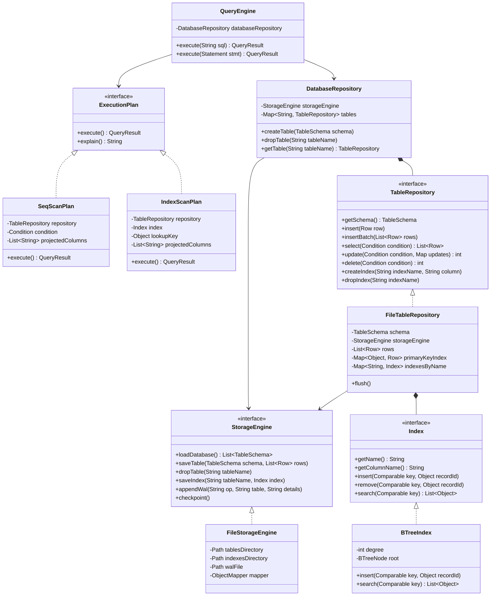

# Simple DBMS (Java)

Упрощённая реляционная система управления базами данных (СУБД) на Java 17 с дисковым JSON-хранилищем, B-Tree индексами, синтаксическим анализатором SQL, поддержкой ссылочной целостности, журналом упреждающей записи (WAL), интерактивной консолью (CLI) и графическим интерфейсом на Swing.

---

## 1. Архитектура системы

Архитектура системы построена по многоуровневому принципу (Layered Architecture) с разделением ответственности между синтаксическим анализом, оптимизацией запросов, репозиторным доступом к данным, индексированием и физическим хранилищем.

### Основные компоненты и паттерны проектирования:
- **Presentation Layer**: 
  - `ConsoleApp` — интерактивный терминальный REPL с табличным форматированием через `TablePrinter`.
  - `DatabaseGui` — графический интерфейс на Java Swing (редактор SQL, дерево таблиц, визуализация структуры и результатов).
- **SQL Parser & AST**:
  - `SqlLexer` и `SqlParser` — лексический и рекурсивно-нисходящий синтаксический анализ SQL-выражений (DDL, DML, Explain, Describe).
  - `Statement` и конкретные AST-узлы (`SelectStatement`, `InsertStatement`, `CreateTableStatement` и др.).
- **Query Engine & Optimization**:
  - `QueryEngine` — диспетчер выполнения команд.
  - **Plan / Strategy**: интерфейс `ExecutionPlan` с реализациями `SeqScanPlan` (полное сканирование таблицы) и `IndexScanPlan` (выборка по B-дереву).
- **Repository Layer**:
  - **Repository**: `DatabaseRepository` — фасад управления базой данных и жизненным циклом таблиц.
  - `TableRepository` / `FileTableRepository` — управление метаданными таблицы, строками в памяти, первичными ключами (`primaryKeyIndex`), внешними ключами (`ForeignKey`) и вторичными индексами.
  - **Iterator**: `RowIterator` — потоковый обход строк таблицы при сканировании.
- **Indexing Layer**:
  - Интерфейс `Index` и реализация сбалансированного дерева `BTreeIndex` (параметр степени $t=3$, расщепление узлов, логарифмический поиск $O(\log N)$).
- **Storage & Durability Layer**:
  - **DAO / Storage Engine**: `StorageEngine` / `FileStorageEngine` — дисковая персистентность таблиц и индексов в JSON с атомарной перезаписью файлов (`.tmp` + `ATOMIC_MOVE`).
  - **Write-Ahead Logging (WAL)**: `wal.log` и `WalEntry` — упреждающая фиксация изменений, контрольные точки `checkpoint()` и автоматическое восстановление/реконсиляция при запуске.

### Диаграмма классов


### Диаграммы последовательностей

#### 1. Выполнение запроса SELECT с оптимизацией через B-Tree индекс
```mermaid
sequenceDiagram
    autonumber
    actor User as Клиент (CLI / GUI)
    participant Engine as QueryEngine
    participant Plan as IndexScanPlan
    participant Repo as FileTableRepository
    participant Index as BTreeIndex

    User->>Engine: execute("SELECT brand, price FROM cars WHERE brand = 'Toyota';")
    Engine->>Repo: getIndexForColumn("brand")
    Repo-->>Engine: BTreeIndex (idx_cars_brand)
    Engine->>Plan: new IndexScanPlan(Repo, Index, "Toyota", ["brand", "price"])
    Engine->>Plan: execute()
    Plan->>Index: search("Toyota")
    Index-->>Plan: [recordId = 1]
    Plan->>Repo: findByPrimaryKey(1)
    Repo-->>Plan: Row(id=1, brand="Toyota", price=25000.0, ...)
    Plan-->>Engine: QueryResult (строки, проекция, время выполнения)
    Engine-->>User: Форматированная таблица результата
```

#### 2. Выполнение запроса INSERT с фиксацией в WAL и сохранением на диск
```mermaid
sequenceDiagram
    autonumber
    actor User as Клиент (CLI / GUI)
    participant Engine as QueryEngine
    participant Repo as FileTableRepository
    participant Storage as FileStorageEngine
    participant Index as BTreeIndex

    User->>Engine: execute("INSERT INTO cars VALUES (1, 'Toyota', 25000.0, true, '2024-01-15', 1);")
    Engine->>Repo: insert(row)
    Note over Repo: Проверка типов, NOT NULL, уникальности PK и связей FK
    Repo->>Storage: appendWal("INSERT", "cars", "pk=1")
    Storage-->>Repo: WAL записан (fsync)
    Repo->>Index: insert("Toyota", recordId=1)
    Index-->>Repo: B-дерево сбалансировано
    Repo->>Storage: saveTable(schema, rows)
    Note over Storage: Запись во временный файл .tmp и ATOMIC_MOVE
    Repo->>Storage: saveIndex("cars", index)
    Storage-->>Repo: Данные сохранены
    Repo-->>Engine: OK (вставлена 1 строка)
    Engine-->>User: QueryResult (affected: 1)
```

---

## 2. Результаты тестирования производительности

В СУБД встроен бенчмарк (`BenchmarkRunner`), выполняющий сопоставление скорости выборки строк при помощи полного последовательного сканирования таблицы (`SeqScan`) и при помощи поиска по сбалансированному B-дереву (`IndexScan`).

### Методология тестирования:
- Генерация таблиц разного объема ($N \in \{500, 2000, 5000, 10000\}$ записей) с кардинальностью строкового поля `brand` равной 100.
- Для каждого объема данных выполняется 20 предварительных прогревочных запросов (warm-up) для исключения влияния JIT-компиляции JVM.
- Измерение среднего времени отклика проводится по выборке из **50 последовательных запросов** с точностью до наносекунд (`System.nanoTime()`).
- Замер выполняется сначала для `SeqScan` (без индекса), затем создается B-Tree индекс и повторяется замер для `IndexScan`.

### Результаты замеров:
Запуск: `java -jar target/simple-dbms-1.0.0.jar --benchmark`

| Число записей ($N$) | SeqScan без индекса (мс) | IndexScan с B-Tree (мс) | Ускорение (Speedup) |
|:-------------------:|:------------------------:|:-----------------------:|:-------------------:|
| 500                 | 0.2213                   | 0.0678                  | **3.27x**           |
| 2 000               | 0.1481                   | 0.0322                  | **4.61x**           |
| 5 000               | 0.5917                   | 0.0423                  | **13.99x**          |
| 10 000              | 1.0045                   | 0.0315                  | **31.92x**          |

### Анализ эффективности:
- **Последовательное сканирование (`SeqScan`)** требует поочередного обхода каждой записи таблицы со сложностью $O(N)$. С ростом объема данных время выполнения растет линейно (при $N=10\,000$ достигает $\approx 1.0$ мс).
- **Индексный поиск (`IndexScan`)** осуществляет спуск по сбалансированному B-дереву со сложностью $O(\log N)$ с последующей мгновенной выборкой строки по первичному ключу из хеш-индекса в памяти за $O(1)$.
- При объеме 10 000 строк использование B-Tree индекса обеспечивает **более чем 30-кратное ускорение** выборки по сравнению с полным сканированием.

---

## 3. Инструкция пользователя

### Требования к окружению и сборка
- **Java SE Development Kit**: версия 17 или новее.
- **Apache Maven**: версия 3.8 или новее.

```bash
# Клонирование репозитория (при необходимости)
git clone git@github.com:DanislonZombovich/simple-db.git
cd simple-db

# Сборка проекта и создание исполняемого fat-JAR со всеми зависимостями
mvn clean package

# Запуск полного набора модульных и интеграционных тестов
mvn test
```

### Способы запуска
СУБД поддерживает четыре режима работы через аргументы командной строки:

```bash
# 1. Интерактивная консоль (CLI / REPL)
java -jar target/simple-dbms-1.0.0.jar

# 2. Графический интерфейс пользователя (Swing GUI)
java -jar target/simple-dbms-1.0.0.jar --gui

# 3. Запуск нагрузочного бенчмарка производительности (SeqScan vs IndexScan)
java -jar target/simple-dbms-1.0.0.jar --benchmark

# 4. Инициализация демонстрационных таблиц и тестовых данных
java -jar target/simple-dbms-1.0.0.jar --init-demo
```

### Примеры команд SQL и интерактивного взаимодействия

#### Создание таблиц и внешних ключей (DDL):
```sql
-- Таблица производителей
CREATE TABLE manufacturers (
    id INT PRIMARY KEY,
    name VARCHAR,
    country VARCHAR
);

-- Таблица автомобилей со ссылкой на производителя
CREATE TABLE cars (
    id INT PRIMARY KEY,
    brand VARCHAR,
    price DOUBLE,
    is_available BOOLEAN,
    created_at DATE,
    manufacturer_id INT REFERENCES manufacturers(id)
);

-- Создание B-Tree индекса для ускорения поиска по марке
CREATE INDEX idx_cars_brand ON cars (brand);
```

#### Манипуляция данными (DML):
```sql
-- Вставка данных в родительскую таблицу
INSERT INTO manufacturers VALUES (1, 'Toyota Motor Corp', 'Japan');
INSERT INTO manufacturers VALUES (2, 'Bayerische Motoren Werke AG', 'Germany');

-- Вставка данных в дочернюю таблицу (с валидацией FK)
INSERT INTO cars VALUES (1, 'Toyota', 25000.0, TRUE, '2024-01-15', 1);
INSERT INTO cars (id, brand, price, manufacturer_id) VALUES (2, 'BMW', 35000.0, 2);

-- Пакетная вставка (Batch Insert)
INSERT INTO manufacturers VALUES (3, 'Ford', 'USA'), (4, 'Volvo', 'Sweden');

-- Выборка всех записей
SELECT * FROM cars;

-- Выборка с фильтрацией и проекцией колонок
SELECT brand, price FROM cars WHERE price >= 25000.0 AND is_available = TRUE;

-- Обновление записей
UPDATE cars SET price = 28000.0 WHERE id = 1;

-- Удаление записей
DELETE FROM cars WHERE brand = 'BMW';
```

#### Инспекция метаданных и анализ планов выполнения:
```sql
-- Просмотр плана выполнения запроса (SeqScan или IndexScan)
EXPLAIN SELECT * FROM cars WHERE brand = 'Toyota';

-- Список всех существующих таблиц в БД
SHOW TABLES;

-- Подробная схема таблицы (колонки, типы, PK, FK, Nullable)
DESCRIBE cars;

-- Список созданных индексов для указанной таблицы
SHOW INDEXES FROM cars;

-- Удаление индекса и таблицы
DROP INDEX idx_cars_brand ON cars;
DROP TABLE cars;
DROP TABLE manufacturers;
```

#### Интерактивные команды CLI:
- `help` — вывод краткой справки по поддерживаемому синтаксису и командам.
- `init-demo` — генерация демонстрационной базы данных.
- `exit` или `quit` — корректное завершение сеанса работы.

---

## 4. Область ответственности каждого участника

Разработка СУБД выполнялась командой из трёх человек со следующим распределением зон ответственности:

### Даниил Егоров
- **Подсистема дискового хранения (`storage`)**:
  - Проектирование архитектуры интерфейса `StorageEngine` и файловой реализации `FileStorageEngine`.
  - JSON-сериализация и десериализация метаданных схем, таблиц и структуры узлов B-дерева через Jackson Databind.
  - Обеспечение атомарности файловых операций (запись во временные файлы `.tmp` с последующей атомарной заменой через `ATOMIC_MOVE`).
- **Транзакционная надёжность и восстановление (`WAL`)**:
  - Реализация упреждающего журнала транзакций `wal.log` и формата записей `WalEntry`.
  - Механизм контрольных точек `checkpoint()` и сброса буферов на диск.
  - Алгоритмы автоматического восстановления согласованности и реконсиляции B-Tree индексов при аварийном завершении работы.
- **Репозиторный слой и доменные сущности**:
  - Реализация интерфейсов `TableRepository`, `FileTableRepository` и координатора `DatabaseRepository`.
  - Валидация первичных ключей (`primaryKeyIndex`), ограничений `NOT NULL` и внешних ключей (`ForeignKey`) при каскадных операциях.
  - Реализация доменных моделей: `TableSchema`, `Column`, `DataType` (`INT`, `DOUBLE`, `VARCHAR`, `DATE`, `BOOLEAN`), `Row`, `QueryResult`.
- **Инфраструктура и управление зависимостями**:
  - Настройка конфигурации проекта `pom.xml`, компилятора Java 17, `maven-shade-plugin` для сборки fat-JAR.

### Егор Глазов
- **Алгоритмы индексации (`index`)**:
  - Проектирование контракта `Index` и реализация сбалансированного $B$-дерева `BTreeIndex` и его узлов `BTreeNode`.
  - Реализация операций поиска по ключу со сложностью $O(\log N)$, расщепления переполненных узлов при вставке, балансировки дерева и диапазонного поиска.
  - Сериализуемое представление состояния B-дерева для сохранения и быстрого восстановления с диска.
- **Синтаксический и лексический анализ SQL (`sql`)**:
  - Разработка лексического анализатора `SqlLexer` и токенизатора `Token`, `TokenType`.
  - Разработка рекурсивно-нисходящего синтаксического анализатора `SqlParser`.
  - Поддержка синтаксических конструкций: приоритеты логических связок `AND` и `OR`, вложенные логические выражения со скобками, предикаты `IS NULL` / `IS NOT NULL`, операции сравнения `ComparisonOperator` (`=`, `!=`, `<`, `<=`, `>`, `>=`).
- **AST-модели команд**:
  - Создание классов синтаксического дерева: `CreateTableStatement`, `DropTableStatement`, `CreateIndexStatement`, `DropIndexStatement`, `InsertStatement`, `SelectStatement`, `UpdateStatement`, `DeleteStatement`, `ExplainStatement`, `ShowTablesStatement`, `ShowIndexesStatement`, `DescribeTableStatement`.

### Максим Жулин
- **Движок выполнения и оптимизации запросов (`engine`)**:
  - Разработка исполнителя запросов `QueryEngine`, маршрутизация команд по AST.
  - Разработка планировщика выполнения запросов `ExecutionPlan` и алгоритма выбора стратегии доступа: `IndexScanPlan` при наличии подходящего B-Tree индекса и оператора `=` либо `SeqScanPlan` при отсутствии индекса.
- **Пользовательские интерфейсы (`ui`)**:
  - Консольное интерактивное приложение `ConsoleApp` (REPL) с табличной псевдографикой (`TablePrinter`), измерением времени выполнения запросов и подсчетом затронутых строк.
  - Графический интерфейс на Java Swing (`DatabaseGui`): дерево объектов базы данных, многострочный редактор SQL с историей, интерактивная таблица `JTable` для отображения результатов, информационная панель со схемой выбранной таблицы и планом `EXPLAIN`.
- **Нагрузочное тестирование и бенчмаркинг**:
  - Разработка модуля сравнительного тестирования `BenchmarkRunner` (замеры производительности `SeqScan` vs `IndexScan` на масштабах до 10 000 строк с расчетом ускорения).
- **Модульное и интеграционное тестирование**:
  - Создание тестовых наборов JUnit 5: `BTreeIndexTest`, `SqlParserTest`, `QueryEngineTest`, `StorageEngineTest`, `ForeignKeyTest`, `DataTypeTest`, `DatabaseGuiTest` и комплексных тестов целостности и граничных случаев `EdgeCaseAndIntegrityTest`.

---

## 5. Выводы

1. **Реализация реляционной модели**: Разработана законченная автономная реляционная СУБД на языке Java 17, реализующая базовые реляционные концепции: строгую типизацию по 5 типам данных (`INT`, `DOUBLE`, `VARCHAR`, `DATE`, `BOOLEAN`), ограничения целостности (`PRIMARY KEY`, `NOT NULL`, `FOREIGN KEY`) и поддержку ключевого подмножества языка SQL (DDL, DML, EXPLAIN, сервисные команды).
2. **Эффективность индексирования**: Практические замеры производительности подтвердили теоретическую асимптотику поиска. Применение B-дерева со сложностью $O(\log N)$ взамен последовательного сканирования со сложностью $O(N)$ обеспечивает ускорение выборки до **31.9x** на таблицах размером 10 000 строк.
3. **Надёжность и сохранность данных**: Использование журнала предзаписи (WAL) и атомарных файловых операций гарантирует целостность базы данных при аварийных сбоях и перезапусках, предотвращая потерю и повреждение таблиц и индексов.
4. **Удобство использования**: Наличие как интерактивного консольного интерфейса (CLI) с табличным форматированием, так и полноценного графического интерфейса на Java Swing (GUI) обеспечивает удобство интерактивной работы, администрирования схем и демонстрации функционала СУБД.

---

## 6. Список использованных источников

1. **Кормен, Т.** Алгоритмы: построение и анализ / Т. Кормен, Ч. Лейзерсон, Р. Ривест, К. Штайн. — 4-е изд. — Москва : ООО «И.Д. Вильямс», 2022. — 1328 с. — (Глава 18: B-деревья, с. 533–558). — ISBN 978-5-907114-11-2.
2. **Гарсиа-Молина, Г.** Системы баз данных. Полный курс / Г. Гарсиа-Молина, Д. Ульман, Д. Уидом. — Москва : ООО «И.Д. Вильямс», 2003. — 1088 с. — (Глава 13: Элементы дискового хранения; Глава 14: Индексные структуры; Глава 15: Выполнение запросов). — ISBN 5-8459-0452-2.
3. **Дейт, К. Дж.** Введение в системы баз данных / К. Дж. Дейт. — 8-е изд. — Москва : ООО «И.Д. Вильямс», 2005. — 1328 с. — (Реляционная модель данных и ссылочная целостность). — ISBN 5-8459-0788-2.
4. **Oracle Corporation.** Java Platform, Standard Edition 17 API Specification. Java SE 17 Documentation. — URL: [https://docs.oracle.com/en/java/javase/17/docs/api/](https://docs.oracle.com/en/java/javase/17/docs/api/) (дата обращения: 15.11.2024).
5. **FasterXML.** Jackson Databind Documentation and Project Repository. — URL: [https://github.com/FasterXML/jackson-databind](https://github.com/FasterXML/jackson-databind) (дата обращения: 15.11.2024).
